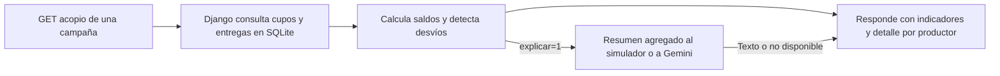

# AgriTrace · Demo de backend y datos

**¿Qué productores de una campaña superaron su cupo de acopio y por cuántos kilos?** AgriTrace es una demo de portafolio inspirada en esa pregunta operativa de AgroTrace. La implementación y los datos ficticios viven en este repositorio. La API usa Django y SQLite.

**Mi aporte — Aquiles Claudio.** Elegí el caso de acopio, definí que el saldo debía conservar el signo y pedí cubrir los límites de la regla y la caída del proveedor de IA. Delimité qué información podía usar la demo. Codex generó el código y las pruebas con esas pautas. La [bitácora](docs/bitacora.md) distingue las comprobaciones del asistente de mi revisión personal.

## Flujo



Cada entrega pertenece al cupo de un productor en una campaña. El backend suma las entregas y calcula `saldo_kg = cupo_kg - acopiado_kg` en kilos enteros. El desvío se activa solo si el saldo es menor que cero. `exceso_total_kg` suma los excesos individuales, incluso si otros productores todavía tienen saldo disponible.

## Probar en local

Usá Python 3.10 a 3.14. Ejecutá estos comandos desde la raíz del repositorio en PowerShell.

```powershell
python -m venv .venv
.\.venv\Scripts\python.exe -m pip install -r requirements.txt
.\.venv\Scripts\python.exe manage.py migrate
.\.venv\Scripts\python.exe manage.py loaddata acopio_demo
.\.venv\Scripts\python.exe manage.py runserver 127.0.0.1:8000
```

En Linux o macOS usá `python3` para crear el entorno y `.venv/bin/python` para los demás comandos. En otra terminal, consultá el endpoint. En Linux o macOS usá `curl` en lugar de `curl.exe`.

```powershell
curl.exe -i http://127.0.0.1:8000/api/campanas/demo-2026/acopio/
```

La campaña de ejemplo devuelve HTTP 200 con este JSON.

```json
{
  "campana": "demo-2026",
  "resumen": {
    "productores_con_cupo": 3,
    "cupo_total_kg": 2300,
    "acopiado_total_kg": 2025,
    "productores_con_desvio": 1,
    "exceso_total_kg": 125
  },
  "productores": [
    {"productor": "P-001", "cupo_kg": 1000, "acopiado_kg": 600, "saldo_kg": 400, "desvio": false},
    {"productor": "P-002", "cupo_kg": 800, "acopiado_kg": 800, "saldo_kg": 0, "desvio": false},
    {"productor": "P-003", "cupo_kg": 500, "acopiado_kg": 625, "saldo_kg": -125, "desvio": true}
  ]
}
```

Con `/api/campanas/inexistente/acopio/` obtenés HTTP 404 y `{"error":"campana_inexistente"}`.

## Explicación opcional

Agregá `?explicar=1` a la petición. El modo predeterminado es `simulado` y usa el resumen para redactar una explicación sin conexión.

```powershell
curl.exe -i "http://127.0.0.1:8000/api/campanas/demo-2026/acopio/?explicar=1"
```

Para usar Gemini, configurá `AGRITRACE_EXPLICADOR=gemini` y una clave propia en la variable de entorno `GEMINI_API_KEY` antes de arrancar Django. `GEMINI_MODEL` permite cambiar el modelo y por defecto es `gemini-3.5-flash`. La petición al proveedor contiene una instrucción y los cinco indicadores agregados de `resumen`. [Referencia de Gemini](https://ai.google.dev/api/generate-content)

Si falla el proveedor, el endpoint mantiene HTTP 200 y los mismos indicadores. El campo adicional queda así.

```json
{"explicacion": {"modo": "gemini", "estado": "no_disponible", "texto": null}}
```

## Verificar y diagnosticar

```powershell
.\.venv\Scripts\python.exe manage.py test
.\.venv\Scripts\python.exe manage.py test acopio.tests.AcopioTests.test_exceso_conserva_saldo_negativo_y_marca_desvio
```

1. Contrastá el resultado de `P-003` con las dos entregas de la [carga ficticia](acopio/fixtures/acopio_demo.json). El cálculo es `500 - (300 + 325) = -125 kg`.
2. Si la campaña de ejemplo devuelve 404, comprobá el código `demo-2026` y corré `manage.py loaddata acopio_demo` desde la raíz.
3. Si falla la explicación, revisá la terminal de Django. En modo Gemini, comprobá la configuración del modelo y de la clave. La prueba de fallo simula un tiempo de espera agotado y compara el JSON completo de indicadores con la respuesta sin explicación.

## Consultas de arquitectura

El [esquema analítico ficticio](analytics_example.sql) cubre productores, predios, parcelas, auditorías y variedades. Es un ejemplo SQLite separado del modelo de acopio. El [simulador](ai_agent_simulator.py) elige una consulta predefinida de [`analytics_queries.sql`](analytics_queries.sql), la ejecuta sobre datos en memoria y muestra el resultado. Funciona solo con Python.

```text
python ai_agent_simulator.py
python ai_agent_simulator.py riesgo --campana 2026
python ai_agent_simulator.py variedades
```

- `eudr` agrupa las hectáreas de parcelas con el indicador EUDR ficticio. Devuelve 15 ha en Norte y 6 ha en Sur.
- `riesgo` revisa la última auditoría de cada predio en el año elegido. Para 2026 marca solo Predio Demo B.
- `variedades` usa las hectáreas asignadas a cada variedad. Por ejemplo, Caturra suma 9 ha.
